<a href="https://harishwaran.dpdns.org">
  
</a>

  
  
  
  
  

## About

I'm a technology entrepreneur and the CEO of **Thenam Software Solutions**, a Chennai-based company building software, AI, automation and IoT products. My work sits where engineering meets the business: shipping AI-powered platforms and enterprise software, running a growing startup, and leading the developers, interns and analysts who build it with me.

Trained in Artificial Intelligence and Data Science, I build across machine learning, computer vision, generative and agentic AI, IoT, blockchain and AR/VR. Engineer by training, entrepreneur by choice. I care about what ships, not just what demos.

- 🏢 **CEO, Thenam Software Solutions** (2025 – now): product, delivery and business development; built SMSLA Source360, an enterprise ERP
- ⚙️ **CTO, Hexpertify** (since 2024): architected an AI-powered consulting platform on React, TypeScript, Node.js, Supabase and Gemini
- 🎓 **B.Tech, AI & Data Science**, DMI College of Engineering, Chennai (2022 – 2026)
- 🏆 **Latest win:** DevHub 1.0 at VIT Chennai (Apr 2026) with HypexAI
- 🤝 Open to collaborations and opportunities

## Selected work

<!-- projects:start (generated by scripts/build-art.mjs) -->

<a href="https://zaymazone-taupe.vercel.app"></a>

<a href="https://thenamsoftwaresolutions.com">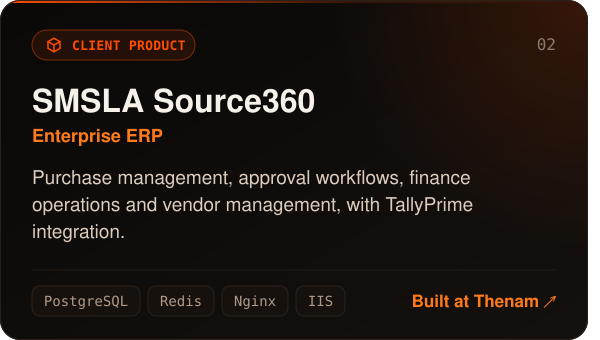</a><a href="https://zara-ai.vercel.app/">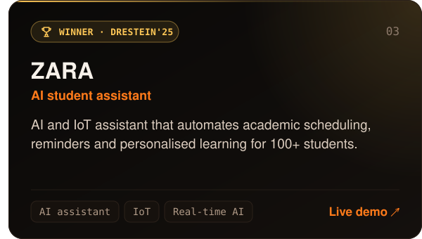</a>

<a href="https://report-x-ai.vercel.app/">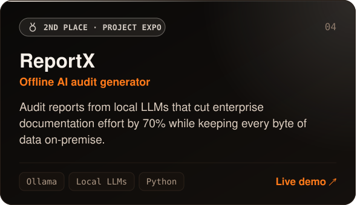</a><a href="https://agrismart-ai-web.vercel.app/">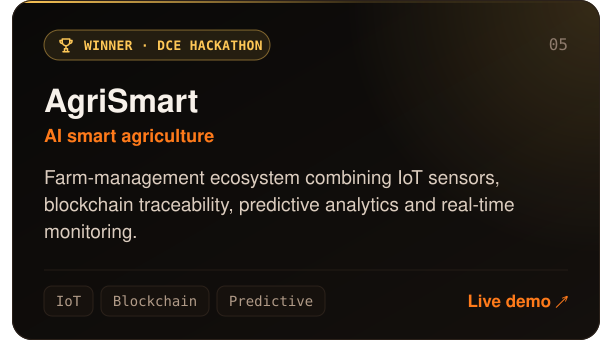</a>

<a href="https://smartbin-ppt.netlify.app/">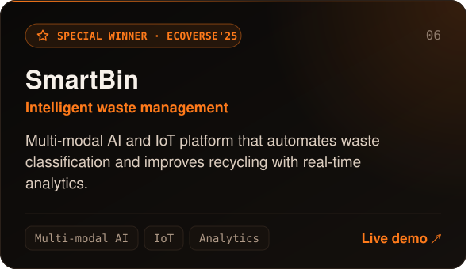</a><a href="https://plan-panni-pannuvom-p3.vercel.app/">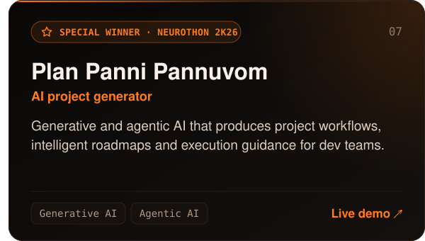</a>

<a href="https://tastylensar.vercel.app/">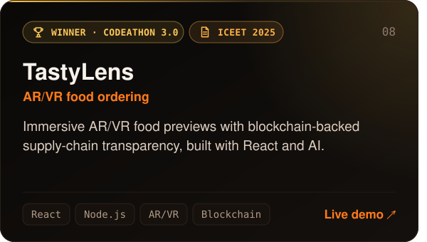</a><a href="https://heal-fit.vercel.app/">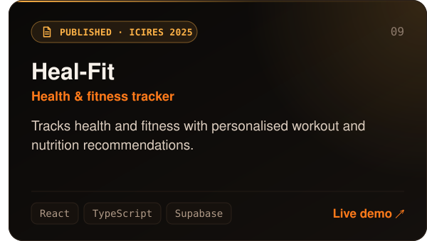</a>

<!-- projects:end -->

## Milestones


<b>All awards, publications and certifications</b>

 

| When | Recognition | Event | Project |
| --- | --- | --- | --- |
| Apr 2026 | 🏆 Winner · ₹10,000 | DevHub 1.0, VIT Chennai | HypexAI |
| Jan 2026 | 🥈 2nd place · ₹8,000 | Project Expo, DMI College of Engineering | ReportX |
| Jan 2026 | 🎖️ Special winner · ₹5,000 | Ecoverse'25, VIT Chennai | SmartBin |
| Aug 2025 | 🏆 Winner · ₹5,000 | DCE Hackathon, Dhanalakshmi College of Engineering | AgriSmart |
| Jun 2025 | 🏆 Winner · ₹10,000 | Drestein'25, Saveetha Engineering College | ZARA |
| Mar 2025 | 🏆 Winner · ₹10,000 | Codeathon 3.0, Prathyusha Engineering College | TastyLens |
| — | 🎖️ Special winner | NEUROTHON 2K26 | Plan Panni Pannuvom |
| — | 🥇 1st place (with Jaswanth Jegan) | Startup Forage, SRMIST | — |
| — | Top 10 | Generative AI Hackathon | Palette AI |
| — | Finalist | National AI Hackathon | — |

**Research:** TastyLens AR (ICEET 2025) · Heal-Fit (ICIRES 2025)

**Certifications:** 20 credentials from Microsoft, LinkedIn Learning, Docker, ServiceNow, Moz, Atlassian and GitHub. [See them on my portfolio ↗](https://harishwaran.dpdns.org)

## Experience

| When | Role | Highlights |
| --- | --- | --- |
| 2025 – now | **CEO**, Thenam Software Solutions | Runs operations, product and delivery; hires and leads developers, interns and analysts; built the SMSLA Source360 ERP |
| 2024 – now | **CTO**, Hexpertify | Led the AI consulting platform; microservices for mental-health, fitness, legal and finance consultations; 60% faster releases with agile |
| Feb – Mar 2025 | **AI & ML Intern**, OneYes InfoTech Solutions | ML, deep learning and NLP on 10,000+ mental-health records; Power BI dashboards; Certificate of Excellence |
| Feb – Mar 2025 | **Data Analyst Intern**, Vulture Lines | Analysis of 50,000+ business records; automated reporting that cut manual effort by 40% |
| Jun – Jul 2024 | **Full Stack Developer Intern**, Novitech | React, Node.js and MongoDB apps with REST APIs; 30% performance gains |
| Nov 2022 – Apr 2023 | **Production & UI/UX Design Intern**, Hyundai Transys Lear | Process monitoring in production; UI/UX prototypes for internal systems |

## Tech stack

<table>
  <tr>
    <td><b>AI & ML</b></td>
    <td>
       
      Deep learning · NLP · Computer vision · YOLOv5 · Generative & agentic AI · Ollama · Gemini API
    </td>
  </tr>
  <tr>
    <td><b>Frontend</b></td>
    <td></td>
  </tr>
  <tr>
    <td><b>Backend & data</b></td>
    <td>
       
      Power BI · Tableau · Pandas · Streamlit · Plotly
    </td>
  </tr>
  <tr>
    <td><b>Cloud & DevOps</b></td>
    <td>
       
      IIS & Windows Server · CI/CD
    </td>
  </tr>
  <tr>
    <td><b>IoT & Web3</b></td>
    <td>
       
      ESP32 · ESP8266 · Edge AI · Hardhat · Ethers.js · AR/VR
    </td>
  </tr>
</table>

## On GitHub

<!-- Both images are rebuilt daily by .github/workflows/profile-assets.yml and published to the `output` branch. -->

<picture>
  <source media="(prefers-color-scheme: dark)" srcset="https://raw.githubusercontent.com/Hari-Eshwaran/Hari-Eshwaran/output/snake-dark.svg" />
  <source media="(prefers-color-scheme: light)" srcset="https://raw.githubusercontent.com/Hari-Eshwaran/Hari-Eshwaran/output/snake-light.svg" />
  
</picture>

